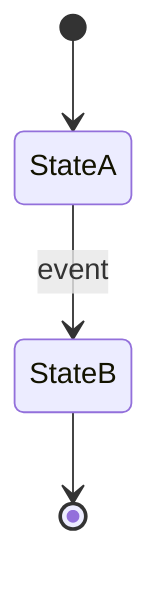

# State Diagram: (대상)

- 코드 위치: (상태 정의·변경 지점)
- 최종 코드 대조일: YYYY-MM-DD

## 다이어그램

## 허용 전이
| From | To | 트리거 이벤트 | 주체 |
|---|---|---|---|

## 금지 전이
| From | To | 금지 사유 | 강제 수단 |
|---|---|---|---|

## 코드-다이어그램 불일치
다이어그램 작성 중 발견한, 코드상 가능하나 다이어그램에 없는 전이.
| 전이 | 코드 위치 | 조치 |
|---|---|---|
